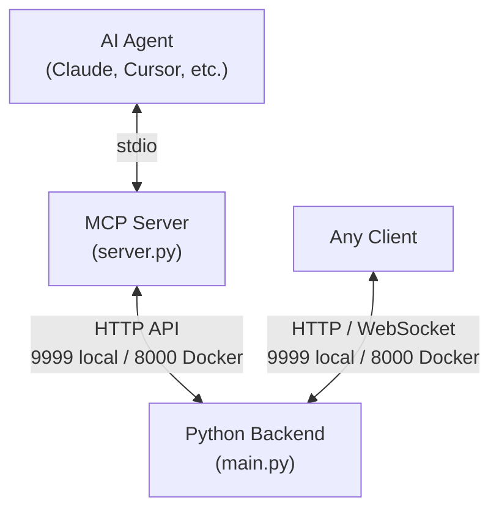

# 🐱 OpenCat Service — AI-Powered Virtual Pet Backend

[中文文档](./README_CN.md)

**OpenCat Service** is the backend component of the OpenCat cyber-pet system. It provides a full pet-state simulation engine, an LLM-driven conversational personality, and REST API / WebSocket interfaces for AI Agents and any client application.

## 🌟 Vision

Traditional desktop pets require constant manual clicking — feeding, playing, cleaning. **OpenCat** flips this model: **your AI assistant becomes the pet's dedicated caretaker**.

An AI Agent interacts with this backend via MCP (Model Context Protocol) tools to feed, water, medicate, and play with the cat. The backend simulates realistic physiological state evolution and uses a Large Language Model (LLM) to generate the cat's unique dialogue and personality.

---

## 💎 Core Feature: End-to-End LLM Interaction System

Unlike traditional virtual pets driven by boring numerical values, **OpenCat** introduces an LLM-based "stream of consciousness" system. Every cat has a soul.

-   **Reactive Interactions**: When the Agent feeds, pets, or cleans the cat, the backend makes a **blocking LLM call** — the cat responds instantly with contextual dialogue.
-   **Proactive Poke**: The cat doesn't always wait to be interacted with. When it's lonely or hasn't been checked on for a while, it proactively sends a "poke" notification.
-   **Observer Effect**: The cat can sense it is being watched. When the Agent queries its status, the cat knows it's being observed and reacts accordingly.
-   **Memory Evolution**: Each cat maintains a `MYOWNER.md` file, recording impressions of its owner. Over time, its speech patterns and attitudes evolve into a unique personality.

---

## 🏗️ Architecture



### Components
1. **Python Backend (`backend/main.py`)**: The core engine. Handles value decay (hunger, thirst, etc.), state computation, LLM dialogue, and data persistence. **Must run as a persistent background service.**
2. **MCP Server (`mcp_server/server.py`)**: A bridge layer. **Automatically spawned and terminated by the AI Agent** when it needs to invoke tools — no manual startup required.

---

## 🚀 Quick Start

We provide one-click setup & run scripts for all major platforms under `setup/`. Each script will automatically:
1. Detect and create an isolated Python virtual environment.
2. Install missing dependencies.
3. Launch the OpenCat service in daemon mode (with auto-restart on crash).

Run **one** of the following commands for your platform:

- **Linux (Ubuntu / CentOS / etc.)**:
  ```bash
  bash setup/run_linux.sh
  ```
- **Windows**:
  ```powershell
  .\setup\run_windows.ps1
  ```
- **macOS**:
  ```bash
  bash setup/run_macos.sh
  ```

The setup scripts start the backend on port `9999`. On the same machine, use `http://127.0.0.1:9999` as the backend URL. Running `backend/main.py` directly also defaults to port `9999` unless you pass `--port`.

### Docker Deployment

```bash
docker-compose up -d
```

The bundled `docker-compose.yml` runs the backend on container port `8000` and publishes it on host port `8000` (`8000:8000`). From the host, use `http://127.0.0.1:8000`. When your AI Agent connects to this Docker deployment, set `OPENCAT_BACKEND_URL` to `http://127.0.0.1:8000` as described below.

> [!IMPORTANT]
> **Configure your LLM API Key**:
> To enable the cat's conversational abilities, you must configure your OpenAI-compatible API Key in `backend/llm_config.json`. Without it, the cat will only return default placeholder messages.

---

## ⚙️ Configure Your AI Agent

Add the MCP server to your Agent's configuration file (e.g. `claude_desktop_config.json`):
```json
{
  "mcpServers": {
    "opencat": {
      "command": "python",
      "args": ["C:/PATH/TO/opencat_service/mcp_server/server.py"],
      "env": {
        "OPENCAT_BACKEND_URL": "http://127.0.0.1:9999"
      }
    }
  }
}
```
The example above connects to the local backend started by the setup scripts. For the bundled Docker deployment on the same machine, change `OPENCAT_BACKEND_URL` to `http://127.0.0.1:8000`. If you use another host or port, set this variable to the backend URL reachable from the MCP server. When omitted, it defaults to `http://127.0.0.1:9999`.

The default MCP transport is `stdio`; it does not need a listening TCP port. `OPENCAT_BACKEND_URL` specifies the HTTP backend that the MCP server connects to.

*Note: If you are using a virtual environment, point `command` to the full path of `.venv/Scripts/python.exe` (Windows) or `.venv/bin/python` (Linux/macOS).*

---

## 📡 REST API Reference

Use the base URL for your deployment:

| Deployment | Base URL on the same machine |
| :--- | :--- |
| Setup scripts or direct Python startup (default) | `http://127.0.0.1:9999` |
| Bundled Docker Compose configuration | `http://127.0.0.1:8000` |

If you change the backend port or Docker host-port mapping, update the base URL and `OPENCAT_BACKEND_URL` accordingly. All endpoints below are relative to that base URL.

| Method | Endpoint | Description |
| :--- | :--- | :--- |
| **GET** | `/adoptable_species` | List all available breeds for adoption |
| **GET** | `/pets` | List IDs and basic info of all adopted pets |
| **GET** | `/pets/{id}/state` | Get full status of a pet. Use `?agent=true` to trigger observer effect |
| **GET** | `/pets/all_states` | Bulk status of all pets (efficient polling) |
| **POST** | `/pets/adopt` | Adopt a new pet (JSON body: `name`, `species`, `gender`) |
| **POST** | `/pets/{id}/feed` | Feed the pet |
| **POST** | `/pets/{id}/water` | Give water |
| **POST** | `/pets/{id}/pet` | Show affection |
| **POST** | `/pets/{id}/clean` | Clean the pet's area |
| **POST** | `/pets/{id}/medicate` | Administer medicine |
| **POST** | `/pets/{id}/chat` | Send a message and receive an LLM-generated reply |
| **GET** | `/pets/{id}/notifications` | Fetch and clear unread notifications |
| **GET** | `/graveyard` | List all deceased pets with their lifespans |
| **GET** | `/graveyard/{id}` | Get details of a specific deceased pet |
| **GET** | `/health` | Health check |

---

## 📁 Project Structure

```
opencat_service/
├── backend/
│   ├── main.py            # Entry point: HTTP server + background state loop
│   ├── api.py             # FastAPI route definitions
│   ├── state_manager.py   # Pet data model & state logic
│   ├── llm_client.py      # LLM API client
│   ├── history_manager.py # Conversation history & memory management
│   ├── llm_config.json    # LLM API configuration
│   ├── CAT.md             # Cat persona system prompt
│   ├── BOOTSTRAP.md       # First-adoption bootstrap prompt
│   └── requirements.txt   # Python dependencies
├── mcp_server/
│   ├── server.py          # MCP protocol server
│   ├── tools.py           # MCP tool definitions
│   └── requirements.txt   # MCP dependencies
├── setup/
│   ├── run_linux.sh       # Linux one-click launcher
│   ├── run_macos.sh       # macOS one-click launcher
│   ├── run_windows.ps1    # Windows one-click launcher
│   └── opencat.service    # systemd service unit
├── AGENT_GUIDE.md         # AI Agent behavior guide & tool reference
├── Dockerfile
├── docker-compose.yml
├── README.md              # This file (English)
└── README_CN.md           # Chinese documentation
```

---

## 🤖 Agent Guide
AI Agents should refer to [**AGENT_GUIDE.md**](./AGENT_GUIDE.md) for behavioral rules and detailed tool documentation.

## 🤖 AI Disclosure
The majority of the code and documentation in this project was generated with the assistance of AI (Large Language Models). The human developer provided the overall architecture design, feature planning, and iterative review, while AI handled most of the implementation and writing.

## 📜 License
This project is released under [The Unlicense](./LICENSE).
