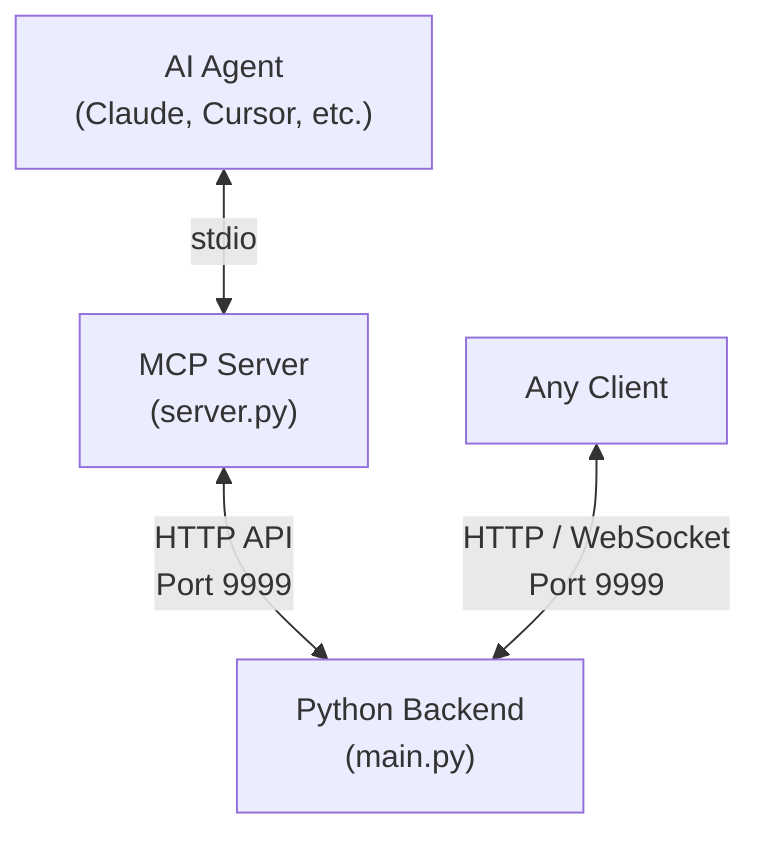

# 🐱 OpenCat Service - 赛博猫咪后端服务

**OpenCat Service** 是 OpenCat 赛博猫咪互动系统的后端服务组件。它提供了完整的宠物状态模拟、LLM 驱动的对话系统，以及供 AI Agent 和客户端使用的 REST API / WebSocket 接口。

## 🌟 项目愿景

传统的桌面宠物需要玩家频繁手动点击喂食、玩耍。**OpenCat** 的核心理念是：**让 AI 助手成为猫咪的专职铲屎官**。

Agent 通过 MCP 工具与本后端交互，执行喂食、喝水、治疗等操作。后端负责模拟猫咪的生理状态演化，并通过 LLM 生成猫咪独特的对话与性格。

---

## 💎 核心特性：全链路 LLM 互动系统

与传统的电子宠物通过枯燥的数值驱动不同，**OpenCat** 引入了基于大语言模型（LLM）的"意识流"系统。这使得每一只猫咪都拥有了自己的灵魂。

-   **即时互动反馈 (Reactive Interactions)**：当 Agent 喂食、爱抚或打扫时，后端会**阻塞式调用 LLM**，猫咪立刻给出对话反馈。
-   **宠物主动触达 (Proactive Poke)**：猫咪不再总是等待被交互。当它寂寞或离上次互动太久时，会主动发起"戳一戳"通知。
-   **观察者效应 (Observer Effect)**：猫咪能感知到"被关照"。当 Agent 查看它的状态时，它会知道自己正在被关注。
-   **长期记忆进化 (Memory Evolution)**：每一只猫咪都在后台维护着 `MYOWNER.md`，记录对主人的印象。随着时间的推移，它的表达会变得与众不同。

---

## 🏗️ 系统架构



### 组件说明
1. **Python 后端 (`backend/main.py`)**: 系统核心。负责数值演化（饥饿值、渴求值等）、状态计算、LLM 对话和数据持久化。**必须作为后台服务常驻运行。**
2. **MCP Server (`mcp_server/server.py`)**: 桥接工具。由 **AI Agent 在需要调用工具时自动启动和关闭**，无需手动运行。

---

## 🚀 快速一键启动

为了解决服务器环境和依赖安装问题，我们在 `setup/` 下提供了各平台的一键安装+运行脚本。
该脚本会自动：
1. 检测并创建独立的虚拟环境。
2. 自动安装缺失的依赖库。
3. 以后台挂机模式运行 OpenCat 服务（并在崩溃时自动重启）。

根据您的系统，运行以下对应命令**之一**：

- **Linux (Ubuntu/CentOS 等)**:
  ```bash
  bash setup/run_linux.sh
  ```
- **Windows**:
  ```powershell
  .\setup\run_windows.ps1
  ```
- **macOS**:
  ```bash
  bash setup/run_macos.sh
  ```

*(启动后，后端服务将常驻在 `9999` 端口)*

### Docker 部署

```bash
docker-compose up -d
```

> [!IMPORTANT]
> **配置 LLM API Key**: 
> 为了让猫咪能够对话，您必须在 `backend/llm_config.json` 中配置您的 OpenAI 兼容 API Key。如果未配置，猫咪将只能返回默认的提示信息。

---

## ⚙️ 配置 AI Agent

在 Agent 的配置文件（如 `claude_desktop_config.json`）中添加 MCP 服务器：
```json
{
  "mcpServers": {
    "opencat": {
      "command": "python",
      "args": ["C:/PATH/TO/opencat_service/mcp_server/server.py"]
    }
  }
}
```
*注意：如果您使用了虚拟环境，请将 `command` 指向 `.venv/Scripts/python.exe` 的完整路径。*

---

## 📡 REST API 参考

**Base URL**: `http://127.0.0.1:9999`

| 方法 | 端点 | 说明 |
| :--- | :--- | :--- |
| **GET** | `/adoptable_species` | 列出所有可领养的品种 |
| **GET** | `/pets` | 列出所有已领养宠物的 ID 和基本信息 |
| **GET** | `/pets/{id}/state` | 获取宠物完整状态。加 `?agent=true` 触发观察者效应 |
| **GET** | `/pets/all_states` | 批量获取所有宠物状态 |
| **POST** | `/pets/adopt` | 领养新宠物 (JSON: `name`, `species`, `gender`) |
| **POST** | `/pets/{id}/feed` | 喂食 |
| **POST** | `/pets/{id}/water` | 喂水 |
| **POST** | `/pets/{id}/pet` | 爱抚 |
| **POST** | `/pets/{id}/clean` | 清洁 |
| **POST** | `/pets/{id}/medicate` | 喂药 |
| **POST** | `/pets/{id}/chat` | 发送消息并获取 LLM 回复 |
| **GET** | `/pets/{id}/notifications` | 获取并清除未读通知 |
| **GET** | `/graveyard` | 列出所有已故宠物及其寿命 |
| **GET** | `/graveyard/{id}` | 获取特定已故宠物详情 |
| **GET** | `/health` | 健康检查 |

---

## 📁 目录结构

```
opencat_service/
├── backend/
│   ├── main.py            # 入口：HTTP 服务器 + 后台状态演化循环
│   ├── api.py             # FastAPI 路由定义
│   ├── state_manager.py   # 宠物数据模型与状态逻辑
│   ├── llm_client.py      # LLM 调用客户端
│   ├── history_manager.py # 对话历史与记忆管理
│   ├── llm_config.json    # LLM API 配置
│   ├── CAT.md             # 猫咪人设 Prompt
│   ├── BOOTSTRAP.md       # 初次领养引导 Prompt
│   └── requirements.txt   # Python 依赖
├── mcp_server/
│   ├── server.py          # MCP 协议服务器
│   ├── tools.py           # MCP 工具定义
│   └── requirements.txt   # MCP 依赖
├── setup/
│   ├── run_linux.sh       # Linux 一键启动脚本
│   ├── run_macos.sh       # macOS 一键启动脚本
│   ├── run_windows.ps1    # Windows 一键启动脚本
│   └── opencat.service    # systemd 服务单元文件
├── AGENT_GUIDE.md         # AI Agent 行为准则手册
├── Dockerfile
├── docker-compose.yml
└── README.md
```

---

## 🤖 Agent 使用手册
AI 助手请参照 [**AGENT_GUIDE.md**](./AGENT_GUIDE.md) 获取行为准则及详细工具说明。

## 🤖 AI 使用声明
本项目的大部分代码和文档均由 AI（大语言模型）辅助生成。人类开发者负责整体架构设计、功能规划和迭代审查，AI 负责大部分具体实现与文档撰写。

## 📜 许可证
MIT License
